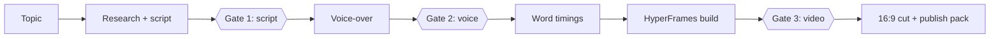

# AI Video Skills

A [Claude Code](https://claude.com/claude-code) skill that turns a topic into a publish-ready tech explainer
reel: researched script, local voice-over, word-level timing, an animated explainer built with
[HyperFrames](https://github.com/heygen-com/hyperframes) in a "Living Diagram" style (or, when you ask, several
creative directions to compare, including [Remotion](https://www.remotion.dev) 3D clips), and a publish pack for Instagram Reels, YouTube Shorts, TikTok, LinkedIn, X, Facebook and a 16:9 YouTube cut.

You give a topic; Claude does the rest and stops for your review at three gates: the **script**, the **voice**
and the **video** you want to publish. Any language your voice engine speaks works; it has been tested with
English and Hindi/Hinglish.

## How it works



Everything between gates runs without you. A reel's `reel.json` records the stage it reached, so any later
session picks up where the last one stopped.

## What you get per reel

- `research.md` with sourced facts, and `script.md`: hook, scenes, narration, timed on-screen beats
- `audio-script.txt`: the whole narration as the voice will read it (audio tags kept, pronunciation fixed),
  ready to paste into ElevenLabs or any TTS; `audio-script.md` adds a plain copy for other platforms
- `audio/vo.wav` from a local voice engine, or imported from ElevenLabs / another platform / your recording,
  with word timings in `words.json`
- the rendered video with a contact sheet; ask for versions and you get two creative directions plus a
  side-by-side `compare.mp4`
- `publish/`: the 9:16 reel, a no-subtitle copy, a 16:9 cut, `captions.srt`/`.vtt`, covers, and per-platform
  captions (`captions.md`)

## Requirements

- Claude Code with the **HyperFrames** plugin (and the **Remotion** plugin for 3D clips)
- Node.js ≥ 22, ffmpeg, [uv](https://docs.astral.sh/uv/) (Python tools run through `uv run` with inline
  dependencies, so nothing is installed globally)
- A voice: [VoiceStudio](https://voicestudio.sh) (default local engine), Chatterbox (installed on first use),
  macOS `say` for drafts — or audio you make on ElevenLabs or any other platform, or record yourself
- ~10 GB free disk: models download to the Hugging Face cache on first use (Whisper large-v3 for alignment
  ~3 GB; OmniVoice and Chatterbox ~3 GB each)

Developed on macOS (Apple silicon). Linux should work except the `say` engine and auto-opening VoiceStudio;
Windows is untested.

## Install

```bash
git clone https://github.com/AashishChakravarty/ai-video-skills.git ~/code/ai-video-skills
ln -s ~/code/ai-video-skills ~/.claude/skills/ai-video-skills      # Claude Code finds the skill here
cd ~/code/ai-video-skills && npm install
npx playwright install chromium                             # headless browser that draws compare.mjs labels
node scripts/config.mjs set handle=@yourhandle channel="Your Channel" language=en reelsRoot=~/reels
node scripts/doctor.mjs                                     # checks everything and prints fixes
```

Plugins, if missing: `claude plugin marketplace add heygen-com/hyperframes && claude plugin install hyperframes`
and `claude plugin marketplace add remotion-dev/skills && claude plugin install remotion`.

To update: `cd ~/code/ai-video-skills && git pull && npm install && node scripts/doctor.mjs`. Your settings and
pronunciation dictionary live outside the repo, so an update never overwrites them.

## Configure

Defaults ship in [`config.default.json`](config.default.json). Your settings live outside the repo in
`~/.config/ai-video-skills/config.json` (or wherever `AI_VIDEO_SKILLS_CONFIG` points) and override the defaults, so
updating the skill never touches them.

```bash
node scripts/config.mjs                         # effective settings; * marks yours
node scripts/config.mjs set language=hi wordsPerSecond=2.35 "cta.spoken=Follow करो!"
node scripts/config.mjs set tts.default=chatterbox tts.chatterboxRef=~/voice/me.wav
node scripts/tts.mjs --engine voicestudio --voices   # your saved VoiceStudio voices
node scripts/config.mjs set tts.voicestudioProfile=<id> "tts.instruct=indian accent"
```

| Key | Meaning |
|---|---|
| `handle`, `channel` | shown in the header and follow CTA; used in captions |
| `channelLogo` | your channel logo (PNG/JPG/WebP), shown round in the follow button |
| `theme`, `themes` | the default theme for new reels, and your own themes (see Themes below) |
| `language`, `voiceStyle`, `onScreenLanguage` | voice-over language code (`en`, `hi`, …), how narration is written, language of on-screen text |
| `reelsRoot` | where new reel folders are created |
| `wordsPerSecond`, `durationTarget` | script length estimates |
| `fps` | frame rate of new reels (default 30) |
| `audioTags` | write ElevenLabs-style audio tags (`[excited]`, `[pause]`…) into the narration |
| `palette` | background, text, success and white; `accent` is `topic` (from each topic's logo) or a fixed `#hex` |
| `fonts.sans`, `fonts.mono` | TTF files for captions/headlines and labels (default covers Latin + Devanagari) |
| `background` | `style` (`dots`, `grid` or `glow`) and the strength of `density`, `drift`, `glow`, `grain` (0–1) and `vignette` |
| `cta.follow`, `cta.spoken` | follow button text and the spoken last line |
| `tts.*` | default engine, VoiceStudio URL and voice, `tts.instruct` (accent/voice design, e.g. `indian accent`), Chatterbox reference clip, macOS voice |
| `sfxDir` | folder of `.mp3` sound effects (default: the HyperFrames media-use library) |

### Themes

A theme is a named brand and look that new reels reuse: handle, channel, follow text and spoken follow line,
channel logo, palette, fonts and background. Anything a theme leaves out comes from your settings above. Three
starter themes ship in [`themes/`](themes): `midnight` (the default: purple night, dot field, accent from the topic),
`terminal` (green on black with a blueprint grid) and `alert` (near-black, red accent, soft glows; made for security
news). Your own themes live in your config.

```bash
node scripts/theme.mjs                                    # every theme; * marks the default
node scripts/theme.mjs save brand --from alert channelLogo=~/brand/logo.png palette.accent=#FF5A5F
node scripts/theme.mjs save second-channel handle=@other channel="Other" background.style=grid
node scripts/theme.mjs default brand                      # new reels use it
node scripts/new-reel.mjs "Kafka consumer groups" --theme terminal   # or pick one per reel
node scripts/theme.mjs apply alert --reel <reel folder>   # switch an existing reel, then scaffold.mjs <v> --sync
```

Each reel keeps a copy of its theme in `reel.json`, so editing a theme later never changes reels you already
made. In Claude Code just say "use the alert theme" or "save this look as my default".

### Pronunciation

Hindi narration keeps tech terms in Latin script ("Elixir में data…"), and voices read those with an English
accent. ai-video-skills respells them in Devanagari for the voice only (data → डाटा) from three layers: a starter
list shipped in [`pronounce/hi.json`](pronounce/hi.json), your personal dictionary
(`~/.config/ai-video-skills/pronounce/<lang>.json`, which grows as you fix words) and the reel's `pronounce.json`.
`node scripts/pronounce.mjs` lists words still missing; `pronounce.mjs set word=respelling` fixes one for good.
Starter lists for more languages are welcome as pull requests.

## Use

In Claude Code, from any folder: `/ai-video-skills`, or just ask — "make a reel about Kafka consumer groups".
Each reel gets its own folder with a `reel.json` that records the stage, so you can stop and resume later.
See [TESTING.md](TESTING.md) for a guided first run.

The scripts also run on their own (each prints its usage at the top of the file):

| Script | Does |
|---|---|
| `doctor.mjs`, `config.mjs` | checks the machine; shows/changes settings |
| `theme.mjs` | lists, saves, sets the default, applies and deletes themes (brand + look) |
| `new-reel.mjs`, `logo.mjs` | creates a reel folder from a theme; sets the topic logo and a contrast-safe accent (simple-icons) |
| `script.mjs vo` / `audio` / `time` | narration from script.md plus the paste-ready audio script; the audio script alone; `@word` beats → spoken times |
| `pronounce.mjs` | words the voice would read with the wrong accent; respellings saved per reel and for all reels |
| `tts.mjs` | voice-over per scene via VoiceStudio, Chatterbox or `say` (audio tags translated), or imports a file |
| `align.py` | forced alignment of the approved script to the audio → `words.json` |
| `scaffold.mjs`, `starter.mjs` | creates/refreshes a version's HyperFrames project (portrait or 16:9); gives it a renderable starter scene per script scene plus a `cues.json` |
| `mix.mjs` | voice + pad bed or ducked music + SFX cues → −14 LUFS |
| `render.mjs`, `contact.mjs`, `compare.mjs` | check + render + contact sheet; side-by-side compare of two versions |
| `srt.mjs`, `cover.mjs`, `publish.mjs` | subtitles, covers and the verified publish pack |

## Layout

```
SKILL.md                 workflow and gates (what Claude reads first)
TESTING.md               setup check, scripts-only pipeline test, full skill test
config.default.json      default settings (yours live in ~/.config/ai-video-skills/config.json)
themes/                  starter themes: midnight, terminal, alert
reference/               script.md · audio.md · build.md · publish.md — per-stage guides
scripts/                 the tools above (Node + uv Python)
pronounce/               starter respellings per voice-over language (hi.json)
templates/reel/          research.md, script.md, pronounce.json for a new reel
templates/hyperframes/   master project: living background, chrome, karaoke captions, shared runtime
templates/remotion/      transparent 3D clip kit (Logo3D, OrthoStage, render-clips.mjs)
examples/                short English and Hindi scripts for testing
assets/                  fonts and GSAP copied into every build
```

## Licences

ai-video-skills is [MIT](LICENSE). It uses, but does not include, tools with their own terms:

- **Remotion** (npm dependency of the 3D clip kit) is free for individuals and companies of up to 3 people;
  larger companies need a [Remotion company licence](https://www.remotion.dev/license).
- **VoiceStudio** is AGPL-3.0; ai-video-skills only talks to its local HTTP API. Voice models carry their own licences.
- **HyperFrames** is Apache-2.0; its plugin and CLI are installed separately.

Bundled third-party files:

- Noto Sans Devanagari and JetBrains Mono (`assets/fonts`, `templates/remotion/public/fonts`): SIL Open Font
  License 1.1, texts next to the fonts.
- GSAP 3.14 (`assets/gsap.min.js`): GreenSock standard licence (free, including commercial use).
- `templates/hyperframes/compositions/components/*`: HyperFrames registry components, Apache-2.0 (`LICENSE` there).
- Topic logos come from [simple-icons](https://simpleicons.org) (CC0) at run time; brand marks remain their
  owners' trademarks — use them editorially.

Clone voices only with the speaker's permission.
